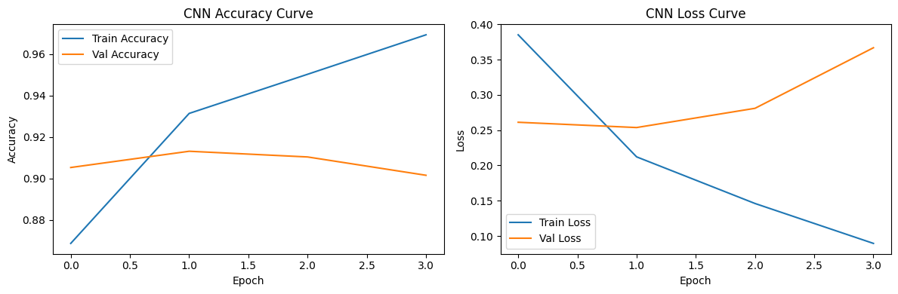
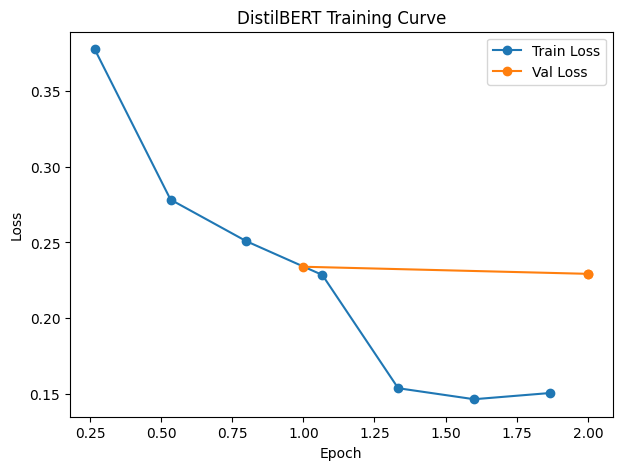
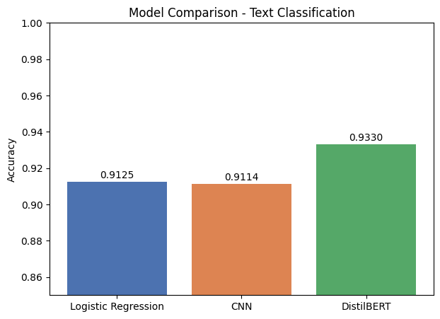
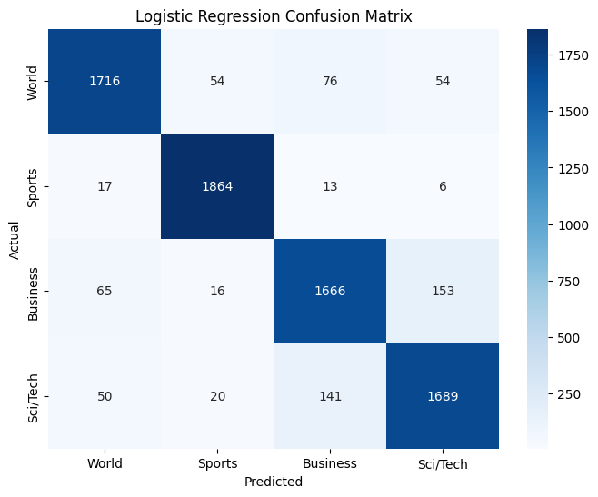
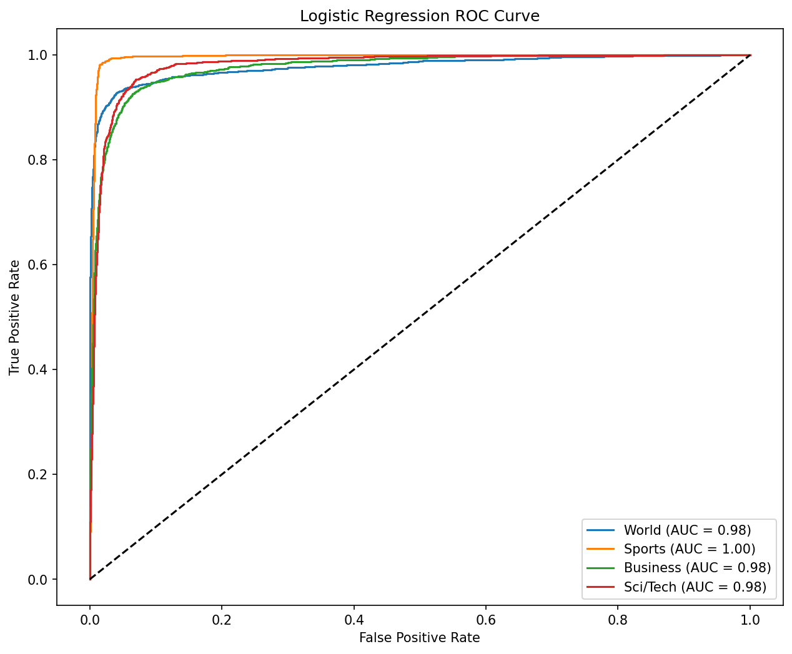
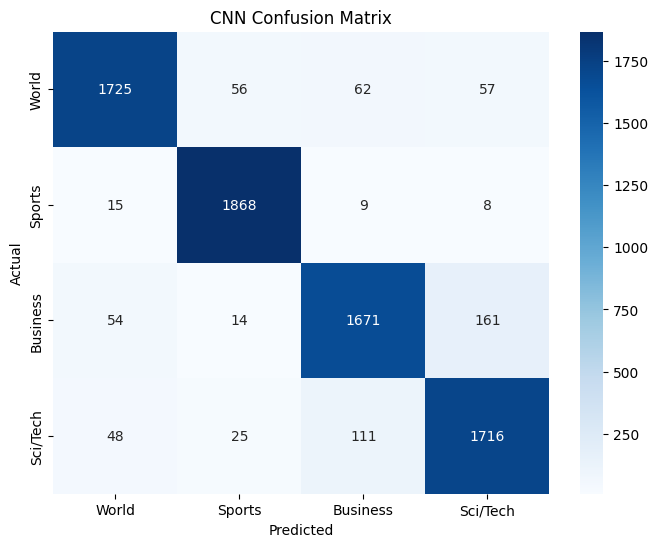
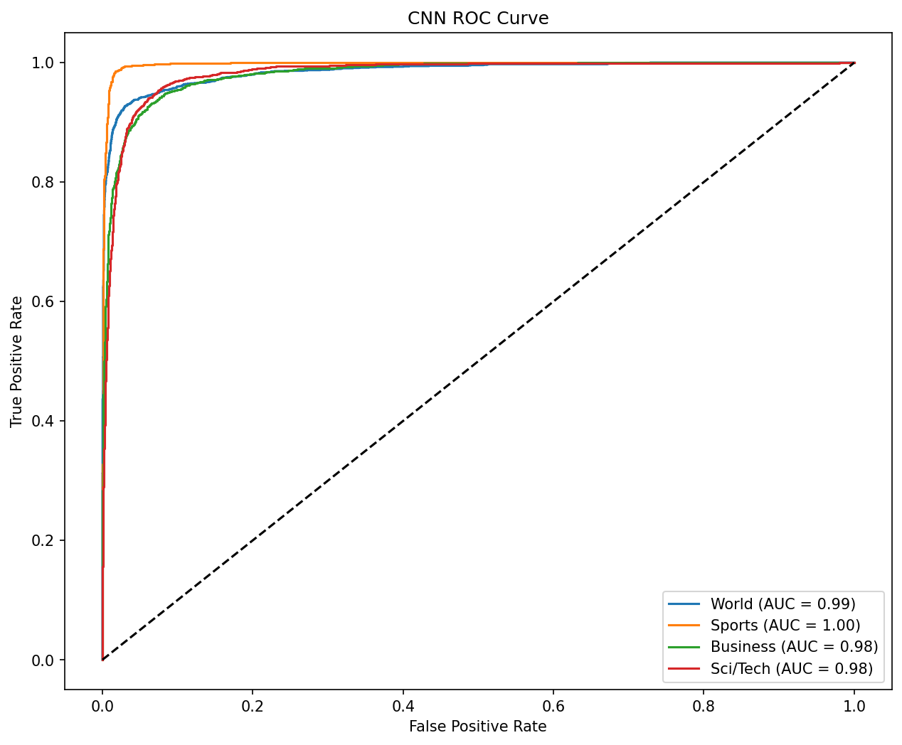
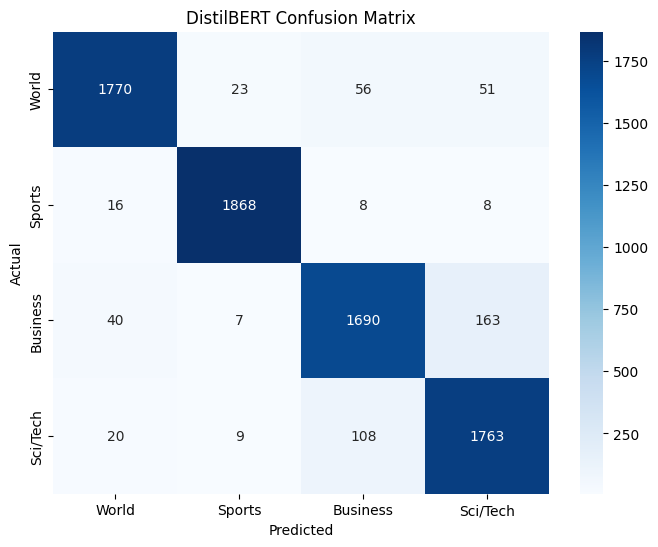
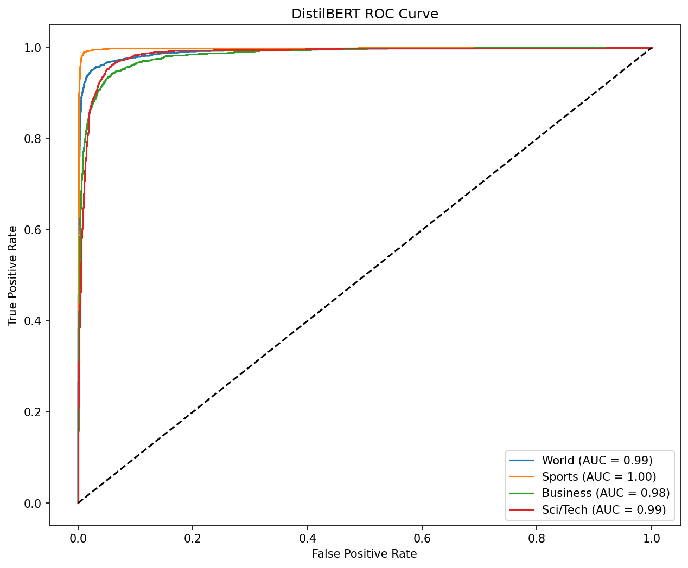

# Project Report: News Text Classification

## 1. Objective

Build and compare three machine learning models to classify news articles into four categories - World, Sports, Business, and Sci/Tech - using the AG News dataset.

## 2. Dataset

- **Source:** AG News (`fancyzhx/ag_news`)
- **Training set:** 120,000 articles, evenly split across 4 classes (30,000 each)
- **Test set:** 7,600 articles (1,900 per class)
- **Fields:** `text` (article headline + snippet), `label` (0-3)
- **Data quality:** No missing values; perfectly balanced classes

## 3. Methodology

### 3.1 Logistic Regression
- Text converted to numeric features using **TF-IDF** (max 10,000 features, English stop words removed)
- Trained with `sklearn.linear_model.LogisticRegression` (max_iter=1000)

### 3.2 CNN
- Text tokenized and padded to a fixed length of 100 tokens (vocabulary size: 10,000)
- Architecture: Embedding (128 dim) -> Conv1D (128 filters, kernel size 5) -> GlobalMaxPooling1D -> Dense(64) -> Dropout(0.5) -> Dense(4, softmax)
- Initial training (5 epochs, no regularization) showed overfitting: training accuracy reached 97.8% while validation accuracy dropped to 89.7%
- **Fix applied:** EarlyStopping (patience=2, restore_best_weights=True), which halted training at the best epoch and improved test accuracy from 90.67% to 91.14%

### 3.3 DistilBERT
- Used `distilbert-base-uncased` (lighter alternative to full BERT, ~97% of BERT's accuracy at a fraction of the training time)
- Trained on a balanced subset of 30,000 rows (full 120,000 was impractical on CPU hardware)
- Fine-tuned for 2 epochs using Hugging Face `Trainer` (batch size 16)
- Training took approximately 10 hours on CPU

## 4. Results

| Model | Accuracy |
|---|---|
| Logistic Regression | 91.25% |
| CNN | 91.14% |
| DistilBERT | **93.30%** |

### 4.1 Logistic Regression - Classification Report

| Class | Precision | Recall | F1-score |
|---|---|---|---|
| World (0) | 0.93 | 0.90 | 0.92 |
| Sports (1) | 0.95 | 0.98 | 0.97 |
| Business (2) | 0.88 | 0.88 | 0.88 |
| Sci/Tech (3) | 0.89 | 0.89 | 0.89 |

### 4.2 CNN - Confusion Matrix and ROC Curve

### 4.3 DistilBERT - Classification Report

| Class | Precision | Recall | F1-score |
|---|---|---|---|
| World (0) | 0.96 | 0.93 | 0.95 |
| Sports (1) | 0.98 | 0.98 | 0.98 |
| Business (2) | 0.91 | 0.89 | 0.90 |
| Sci/Tech (3) | 0.89 | 0.93 | 0.91 |

## 5. Discussion

- All three models performed well above a random baseline (25%), with DistilBERT giving the strongest overall result.
- The CNN's early overfitting highlights the importance of validation monitoring and early stopping, even on relatively clean, balanced data.
- DistilBERT's advantage came from contextual understanding of language, which TF-IDF (bag-of-words) and basic word embeddings can't capture - it better distinguishes between topically similar classes like Business and Sci/Tech.
- Business and Sci/Tech remained the hardest classes to separate across all models, suggesting genuine vocabulary overlap in the source data rather than a model-specific weakness.

## 6. Conclusion

DistilBERT achieved the best accuracy (93.30%) and is the recommended model for deployment. Logistic Regression remains a strong, lightweight baseline (91.25%) with far less computational cost, making it a reasonable choice where speed or simplicity is prioritized over the last few points of accuracy.

## 7. Future Work

- Train DistilBERT on the full 120,000-row dataset (would require GPU access for practical training time)
- Experiment with ensembling predictions across all three models
- Deploy the best-performing model as a live web app (in progress)
